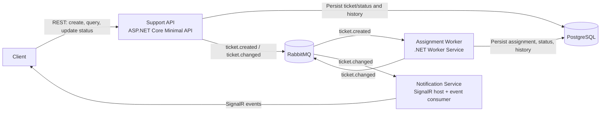

# Kien truc tong the

## Kien truc de xuat

He thong gom dung ba service nghiep vu doc lap, mot message broker va mot co so du lieu quan he. Client la ben tieu thu API/SignalR, khong nam trong Solution cua Phase 2.

## Thanh phan va ranh gioi

- **Support API**: REST interface Minimal API cho nam endpoint bat buoc; ghi nhan ticket, truy van ticket, cap nhat trang thai va phat su kien.
- **RabbitMQ**: kenh bat dong bo giua API, Assignment Worker va Notification Service; tach viec xu ly phan cong va gui thong bao khoi request cua client.
- **Assignment Worker**: consumer chuyen ticket moi thanh ticket da phan cong; ghi thay doi va lich su.
- **Database**: PostgreSQL duoc chon cho luu ticket, user tham chieu, nhom xu ly va lich su. API va Worker dung chung nguon du lieu.
- **Notification Service**: tieu thu su kien thay doi va host SignalR de gui den cac client lien quan.
- **Client**: goi REST va ket noi SignalR; viec tao client thuoc phase rieng, khong tao trong Phase 2.

## Nguyen tac

- REST phuc vu thao tac dong bo tu client; RabbitMQ phuc vu cong viec phan cong va phat su kien bat dong bo.
- Database la nguon su that cho trang thai ticket va lich su.
- Chi phan cong va gui thong bao sau khi thay doi tuong ung duoc ghi vao database.
- Moi service doc lap, cau hinh endpoint/connection qua environment/configuration thay vi hard-code.
- Chi tiet giao thuc va queue nam tai [RabbitMQ va SignalR](05-messaging-and-realtime.md).

## Chon co so du lieu

PostgreSQL la lua chon quan he cho cac lien ket ticket-nguoi-dung-nhom va lich su. Phase 1 chi mo ta mo hinh logic; khong tao schema vat ly, migration, DbContext hay database.

## Phu thuoc va kha nang phuc hoi

- Worker tam dung: RabbitMQ giu thong diep trong queue durable; consumer tiep tuc xu ly khi Worker ket noi lai.
- Notification Service tam dung: su kien thay doi con trong queue durable va duoc gui khi service tro lai.
- Database tam dung: API tra loi loi thay vi xac nhan thanh cong; consumer khong ack thong diep chua ghi duoc database.
- RabbitMQ tam dung: thao tac phat su kien khong the hoan tat; can bao loi ro rang va khong gia lap rang cong viec bat dong bo da thanh cong. Chi tiet xu ly phat hanh va retry can duoc hien thuc/kiem chung o phase tich hop.

Kien truc nay khong them retry queue, dead-letter queue hay transactional outbox vao pham vi co ban.
