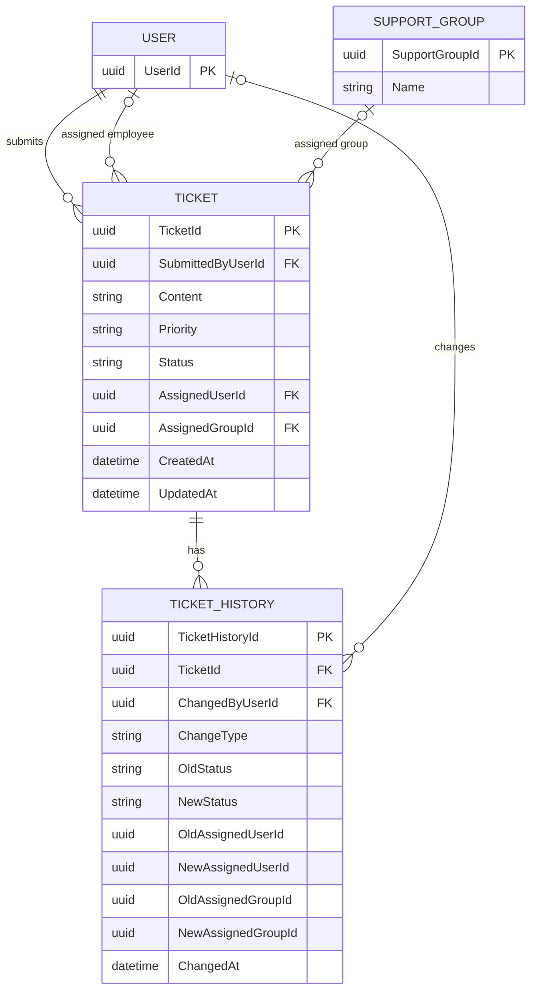

# Thiet ke du lieu va ERD

## Entity muc logic

### User

Luu ID tham chieu cho nguoi gui, nhan vien duoc gan va nguoi thuc hien thay doi. Khong mo ta dang nhap, thong tin ca nhan hay vai tro vi de bai khong yeu cau.

- `UserId` (PK)

### SupportGroup

Nhom co the duoc chon lam dich den phan cong.

- `SupportGroupId` (PK)
- `Name`

### Ticket

- `TicketId` (PK)
- `SubmittedByUserId` (FK -> User)
- `Content`
- `Priority`
- `Status`: `New`, `Assigned`, `InProgress` hoac `Resolved`
- `AssignedUserId` (nullable FK -> User)
- `AssignedGroupId` (nullable FK -> SupportGroup)
- `CreatedAt`
- `UpdatedAt`

Ticket moi chua co dich den. Khi da phan cong, mot ticket duoc gan cho mot nhan vien hoac mot nhom; hai cot dich den khong cung co gia tri.

### TicketHistory

Moi ban ghi luu mot su kien tao ticket, thay doi trang thai hoac thay doi dich den phan cong.

- `TicketHistoryId` (PK)
- `TicketId` (FK -> Ticket)
- `ChangedByUserId` (nullable FK -> User; null khi thay doi do Worker)
- `ChangeType`
- `OldStatus` / `NewStatus` (nullable theo loai thay doi)
- `OldAssignedUserId` / `NewAssignedUserId` (nullable)
- `OldAssignedGroupId` / `NewAssignedGroupId` (nullable)
- `ChangedAt`

## Quan he

## Rang buoc va luu y

- Cac kieu UUID/DateTime la goi y logic; chi tiet kieu PostgreSQL duoc xac dinh luc thiet ke schema that.
- `Status` bi gioi han boi bon gia tri trong de bai; de bai khong quy dinh rang buoc chuyen tiep giua cac trang thai.
- Muc uu tien duoc luu nhung cac muc/thu tu cu the chua duoc de bai quy dinh.
- Doi voi assignment: ticket chua gan co ca hai FK null; ticket da gan co dung mot trong hai FK co gia tri.
- TicketHistory can luu thong tin truoc/sau de xem lai thay doi trang thai va phan cong.
- PostgreSQL va mo hinh tren chi la thiet ke; Phase 1 khong tao database, EF Core, schema, migration hay du lieu mau.
